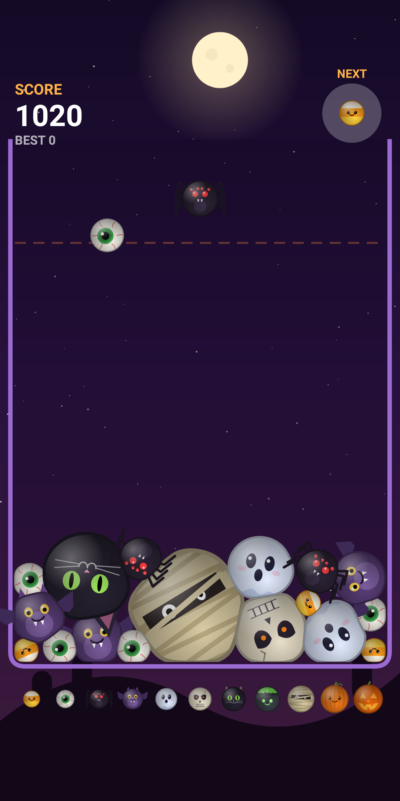

# Suikaween 🎃

A Halloween take on Suika (the watermelon game) for Android. Drop creatures into the jar; two of
the same kind merge into the next one. Don't let the pile cross the dashed line.



## Evolution chain

Candy Corn → Eyeball → Spider → Bat → Ghost → Skull → Black Cat → Cauldron → Mummy → Pumpkin →
Jack-o'-Lantern. Only the first five are ever dropped. Two Jack-o'-Lanterns vanish for a bonus.

## Squishy & slippery

Creatures are soft rather than rigid fruit, which makes the game a bit more forgiving:

- **Low friction** (`World.FRICTION`), so creatures slide past each other and into gaps
  instead of jamming.
- **Soft outlines.** Collision uses a circle a little smaller than the drawn body
  (`COLLIDE_FRACTION`), so neighbours press into each other. Each outline is a ring of springy
  vertices that flatten into a shared contact face, bulge elsewhere to keep their area, and
  wobble on impacts and merges (`World.updateShapes`).
- The physics stays a stable position-based circle solver, so big piles don't jitter or explode.

Every tuning knob is a constant at the top of `World`.

## Build

Requires JDK 17+ and the Android SDK (platform 35).

```sh
./gradlew assembleDebug        # app/build/outputs/apk/debug/app-debug.apk
./gradlew installDebug         # install on a connected device
./gradlew testDebugUnitTest    # physics tests + Robolectric render test
```

The render test writes real frames to `app/build/screenshots/`.

## Code map

- `World.kt`: physics, merging, scoring, game over, and soft-body outlines (pure Kotlin)
- `Tiers.kt`: the creature chain (sizes, colours, points)
- `CreatureArt.kt`: procedural Canvas drawings of every creature (no image assets)
- `GameView.kt`: game loop, rendering, effects, HUD, and touch input
